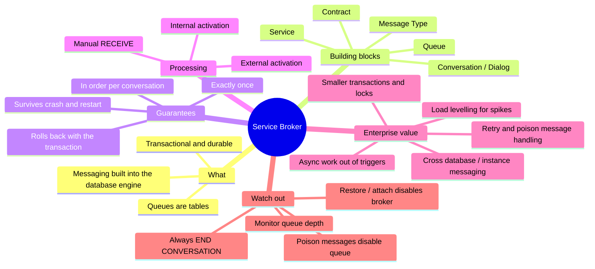
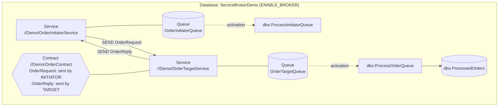
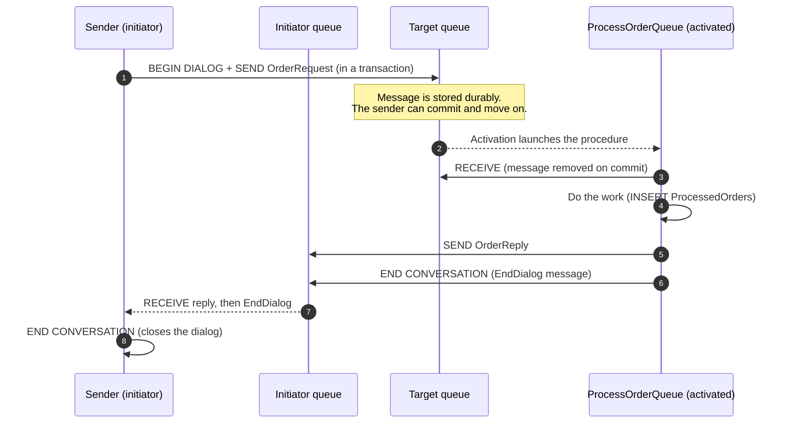
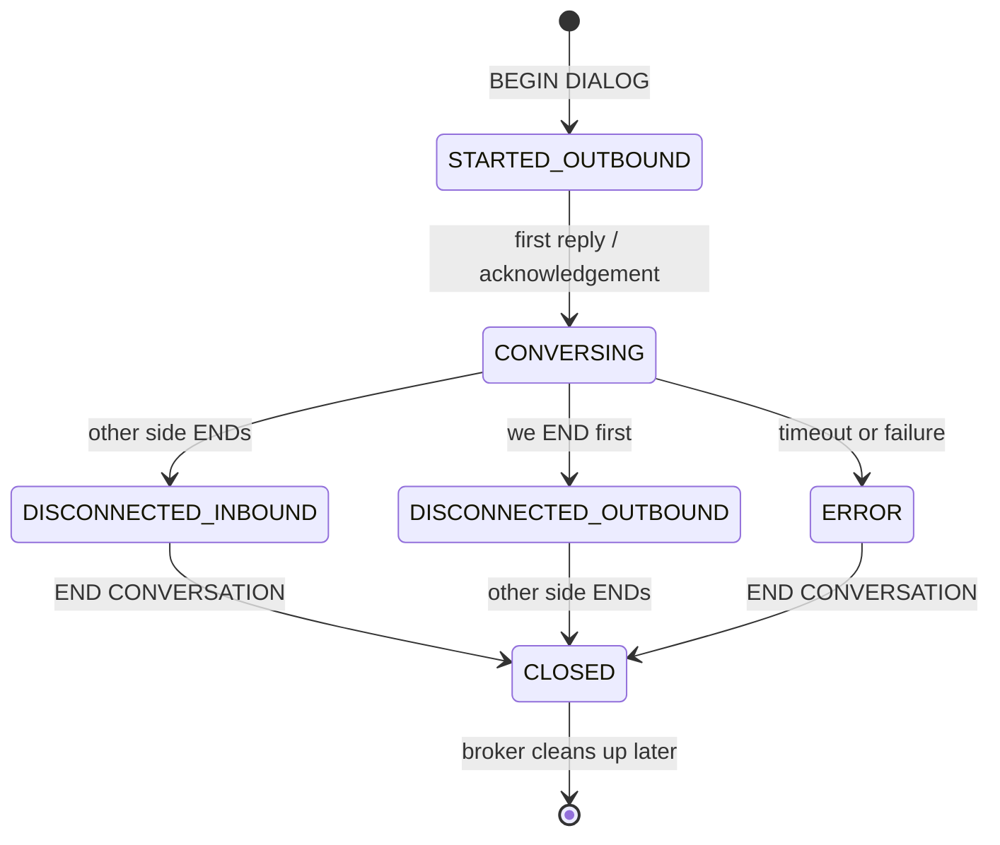
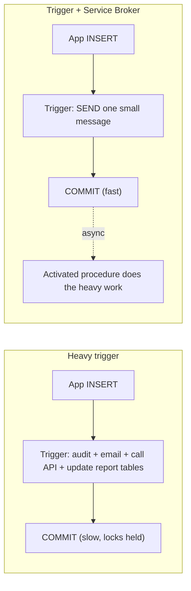

# SQL Server Service Broker Demo - Context

Learning project for SQL Server Service Broker: environment requirements, what was changed on this machine, how the broker works, and how it complements triggers in enterprise applications.

## 1. At a glance



## 2. System requirements

### Environment this demo was built on

| Item           | Value                                                                                    |
| -------------- | ---------------------------------------------------------------------------------------- |
| OS             | Windows 10 Enterprise (build 26100)                                                      |
| SQL Server     | 2025 RTM-GDR (17.0.1115.1), Standard Developer Edition, default instance `MSSQLSERVER` |
| Authentication | Windows authentication (`sqlcmd -S . -E -C`)                                           |
| Tooling        | `sqlcmd` (ODBC 17), PowerShell 7. No .NET code is needed.                              |

### Service Broker requirements

| # | Requirement                                                                                                        | Status here                                                |
| - | ------------------------------------------------------------------------------------------------------------------ | ---------------------------------------------------------- |
| 1 | Edition supports Service Broker (all editions do; Developer has all features)                                      | Met                                                        |
| 2 | Database-level switch enabled: `ALTER DATABASE <db> SET ENABLE_BROKER` (`sys.databases.is_broker_enabled = 1`) | Enabled on the new demo DB                                 |
| 3 | A unique `service_broker_guid` per database                                                                      | Met (copies of a DB need `SET NEW_BROKER`)               |
| 4 | Permissions to create broker objects (`db_owner` or `CONTROL` on the DB)                                       | Met                                                        |
| 5 | Endpoint (`CREATE ENDPOINT ... FOR SERVICE_BROKER`)                                                              | Not needed. Only required for messaging between instances. |
| 6 | Activation procedure runs under a valid principal (`EXECUTE AS OWNER` here)                                      | Met                                                        |

State found on the server before the demo:

| Database                          | `is_broker_enabled` |
| --------------------------------- | --------------------- |
| master, model                     | 0                     |
| tempdb, msdb                      | 1                     |
| DEV_IAE_MATRIX_DATA               | 1                     |
| DEV_IAE_DATA, DEV_IAE_MATRIX_LOGS | 0                     |

No `SERVICE_BROKER` endpoint existed. Existing databases were not touched.

## 3. Changes made on this machine

| Change                                                                           | Where                         | Notes                                                           |
| -------------------------------------------------------------------------------- | ----------------------------- | --------------------------------------------------------------- |
| Created database `ServiceBrokerDemo` with broker enabled                       | Local SQL Server              | The only server-side change. Removable with `04_cleanup.sql`. |
| Created message types, contract, 2 queues, 2 services, `ProcessedOrders` table | `ServiceBrokerDemo`         | [01_setup.sql](01_setup.sql)                                     |
| Created 2 activation procedures and attached them to the queues                  | `ServiceBrokerDemo`         | [03_activation.sql](03_activation.sql)                           |
| Created demo scripts and runner                                                  | `c:\code\ServiceBrokerDemo` | See below                                                       |
| Temporary `Orders` table and trigger, used to verify section 6, then dropped   | `ServiceBrokerDemo`         | Nothing left behind                                             |

No instance configuration, endpoints, logins or other databases were modified.

| File                                    | Purpose                                                  |
| --------------------------------------- | -------------------------------------------------------- |
| [01_setup.sql](01_setup.sql)             | Create DB, enable broker, create all broker objects      |
| [02_manual_flow.sql](02_manual_flow.sql) | One request/reply round trip done by hand                |
| [03_activation.sql](03_activation.sql)   | Automatic processing via internal activation, 5 messages |
| [04_cleanup.sql](04_cleanup.sql)         | Drop the demo DB                                         |
| [run-demo.ps1](run-demo.ps1)             | Runs 01 to 03 (`-Cleanup` runs 04)                     |

Gotcha found while building: `sqlcmd` defaults to `QUOTED_IDENTIFIER OFF`, which makes XML methods such as `.value()` fail with error 1934. Use `sqlcmd -I`, as the runner does.

## 4. Design

### 4.1 Objects



### 4.2 Message flow



### 4.3 Conversation lifecycle



After the demo ran, `sys.conversation_endpoints` showed CLOSED endpoints. This is normal, and the broker removes them in the background.

## 5. How Service Broker works

1. **Message type** names a kind of message and its validation (`WELL_FORMED_XML`, `NONE`, `EMPTY`, or an XML schema).
2. **Contract** lists which message types each side may send (`INITIATOR`, `TARGET` or `ANY`).
3. **Queue** is a hidden table where messages wait. It is durable, logged and recoverable like any table.
4. **Service** is a named address bound to one queue and the contracts it accepts.
5. **Conversation (dialog)** is a long-lived, bidirectional channel between two services. Messages on a conversation are delivered **exactly once and in order**.
6. **`SEND`** puts a message on the conversation, and **`RECEIVE`** takes it off the queue. Both take part in the caller's transaction, so a rollback un-sends or un-receives.
7. **Activation** starts your stored procedure when messages arrive, scaling up to `MAX_QUEUE_READERS` copies.
8. **`END CONVERSATION`** must be called by both sides. Forgotten dialogs leak rows in `sys.conversation_endpoints`.

Key properties:

- **Transactional.** The message commits or rolls back with your data change. The rollback case was verified (see section 6).
- **Asynchronous.** The sender does not wait for the receiver.
- **Reliable.** Messages survive restarts, and across instances they are retried and acknowledged.
- **Poison message protection.** After 5 consecutive rollbacks of a `RECEIVE` on a queue, SQL Server disables the queue. Handle bad messages with `TRY/CATCH` and `END CONVERSATION ... WITH ERROR`.

## 6. Service Broker and triggers

### 6.1 Problem with heavy triggers

A trigger runs **synchronously inside the caller's transaction**. Anything slow in it extends lock duration, slows every `INSERT`/`UPDATE`, and any error rolls back the user's original change. Triggers also cannot call out to other systems safely.



### 6.2 Pattern

The trigger only enqueues. The slow work moves to an activated procedure. This was run against the demo DB and works with the existing `//Demo/OrderRequest` service and `dbo.ProcessOrderQueue`:

```sql
CREATE TRIGGER dbo.trg_Orders_Insert ON dbo.Orders AFTER INSERT AS
BEGIN
    SET NOCOUNT ON;
    DECLARE @h UNIQUEIDENTIFIER, @m NVARCHAR(MAX);
    SET @m = (SELECT OrderId AS Id FROM inserted FOR XML PATH('Order'));

    BEGIN DIALOG CONVERSATION @h
        FROM SERVICE [//Demo/OrderInitiatorService]
        TO SERVICE '//Demo/OrderTargetService'
        ON CONTRACT [//Demo/OrderContract] WITH ENCRYPTION = OFF;

    SEND ON CONVERSATION @h MESSAGE TYPE [//Demo/OrderRequest] (@m);
END
```

Verified results:

- `INSERT` of order 3001 was processed by the `activation` procedure shortly afterwards.
- `INSERT` of order 3002 inside a transaction that was rolled back produced **no** message and no processing. The message rolled back with the data.

The trigger does a set-based insert; for multi-row `inserted`, the message contains all rows, so the receiver must handle several `<Order>` elements in production code. The demo receiver reads only the first.

### 6.3 Comparison

| Concern                          | Heavy trigger             | Trigger + Service Broker                                                          |
| -------------------------------- | ------------------------- | --------------------------------------------------------------------------------- |
| Caller latency                   | Includes all trigger work | Only the cost of one `SEND`                                                     |
| Lock duration                    | Long                      | Short                                                                             |
| Failure in downstream work       | Rolls back user's change  | Isolated; retried or handled by the receiver                                      |
| Traffic spikes                   | Hit the app directly      | Absorbed by the queue (load levelling)                                            |
| Consistency with the data change | Yes                       | Yes, the message is committed or rolled back with it                              |
| Result available immediately     | Yes                       | No, eventual consistency                                                          |
| Cross-database / instance        | Awkward                   | Built in                                                                          |
| Message to external systems      | Unsafe                    | External activation or a worker service reads the queue                           |
| Alternative                      |                           | Outbox table + polling job (simpler but needs polling, no ordering or activation) |

### 6.4 Typical enterprise use cases

- **Audit and history** written outside the user's transaction time.
- **Denormalisation / reporting tables** refreshed asynchronously.
- **Integration events** such as order created, listing changed, or cache invalidation (an external service drains the queue).
- **Batch smoothing**: bulk loads enqueue work that is processed at a controlled rate.
- **Cross-database workflows** that stay transactionally consistent on the sending side.

### 6.5 When not to use it

- The caller needs the result immediately (use a synchronous call).
- The logic must be atomic with the original change (keep it in the trigger or procedure).
- Very high volume integration across many systems where a dedicated message platform (Kafka, Azure Service Bus) is already standard. Service Broker is a good fit when the data and the work live in SQL Server.

## 7. Comic strips

### Strip 1: The slow trigger

```text
+-----------------------+-----------------------+-----------------------+
| PANEL 1               | PANEL 2               | PANEL 3               |
|                       |                       |                       |
|  (o_o)  USER:         |  [ TRIGGER ]          |  (x_x)  USER:         |
|  "Save my order!"     |  "Hold on. Sending    |  "Why is it still     |
|                       |   email... updating   |   spinning??"         |
|        INSERT         |   reports... calling  |                       |
|        =======>       |   an API..."          |   ...locks held...    |
+-----------------------+-----------------------+-----------------------+
```

### Strip 2: Enter the broker

```text
+-----------------------+-----------------------+-----------------------+
| PANEL 1               | PANEL 2               | PANEL 3               |
|                       |                       |                       |
|  (o_o)  USER:         |  [ TRIGGER ]          |  (^_^)  USER:         |
|  "Save my order!"     |  "Got it. Dropping a  |  "Done already!"      |
|                       |   note in the queue." |                       |
|        INSERT         |        [msg] ---> |Q| |   [ WORKER ] (-_-)zzz |
|        =======>       |                       |   "Woke up. Working.."|
+-----------------------+-----------------------+-----------------------+
```

### Strip 3: Rollback safety

```text
+-----------------------+-----------------------+-----------------------+
| PANEL 1               | PANEL 2               | PANEL 3               |
|                       |                       |                       |
|  APP: BEGIN TRAN      |  APP: "Oops, the      |  QUEUE: "No message   |
|  INSERT order 3002    |   payment failed."    |   for 3002? Good."    |
|  trigger SENDs [msg]  |   ROLLBACK;           |                       |
|                       |   [msg] ---> poof!    |  WORKER: "Nothing to  |
|                       |                       |   do. Back to sleep." |
+-----------------------+-----------------------+-----------------------+
```

### Strip 4: The poison message

```text
+-----------------------+-----------------------+-----------------------+
| PANEL 1               | PANEL 2               | PANEL 3               |
|                       |                       |                       |
|  WORKER: RECEIVE msg  |  WORKER: "Rollback    |  QUEUE: "5 strikes.   |
|  -> error -> ROLLBACK |   again... and again" |   I'm disabling       |
|  msg returns to queue |   x5                  |   myself."  (STATUS   |
|                       |                       |   = OFF)              |
|                       |                       |  FIX: TRY/CATCH +     |
|                       |                       |  END CONV WITH ERROR  |
+-----------------------+-----------------------+-----------------------+
```

## 8. Running the demo

```powershell
cd c:\code\ServiceBrokerDemo
.\run-demo.ps1            # setup + manual flow + activation
.\run-demo.ps1 -Cleanup   # drop the demo database
```

Expected: `02_manual_flow.sql` shows the request, reply and `EndDialog` messages, and `ProcessedOrders` has `manual` and `activation` rows (orders 1001 and 2001 to 2005).

## 9. Operational cheat sheet

```sql
-- Is the broker on?
SELECT name, is_broker_enabled FROM sys.databases;

-- Messages waiting
SELECT COUNT(*) FROM dbo.OrderTargetQueue WITH (NOLOCK);

-- Queue / activation state
SELECT name, is_receive_enabled, is_activation_enabled, activation_procedure FROM sys.service_queues;

-- Conversations (look for leaks and ERROR states)
SELECT state_desc, COUNT(*) FROM sys.conversation_endpoints GROUP BY state_desc;

-- Running activation procedures
SELECT * FROM sys.dm_broker_activated_tasks;

-- After restoring a copy of a database
ALTER DATABASE <db> SET ENABLE_BROKER;   -- or SET NEW_BROKER for a clone
```

Common pitfalls:

- Restore or attach disables the broker unless you use `WITH ENABLE_BROKER`.
- Forgetting `END CONVERSATION` on one side causes endpoint leaks.
- A disabled queue (poison message) stops all processing silently, so monitor `is_receive_enabled`.
- A broker-enabled database with a duplicate `service_broker_guid` (from a restore on the same instance) cannot be enabled without `NEW_BROKER`.

## 10. References

- Microsoft Learn: SQL Server Service Broker documentation
- `sys.databases`, `sys.service_queues`, `sys.conversation_endpoints`, `sys.dm_broker_activated_tasks`
